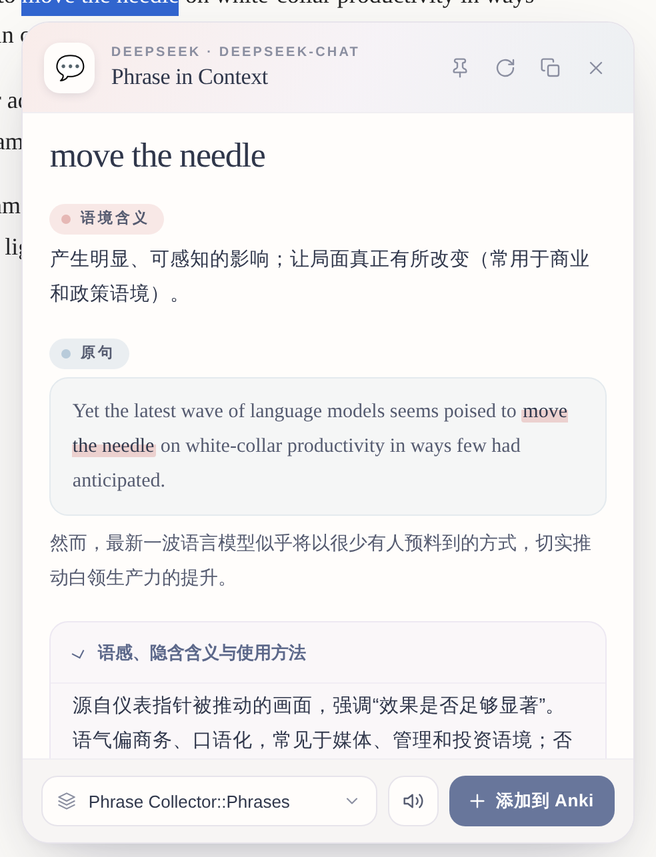
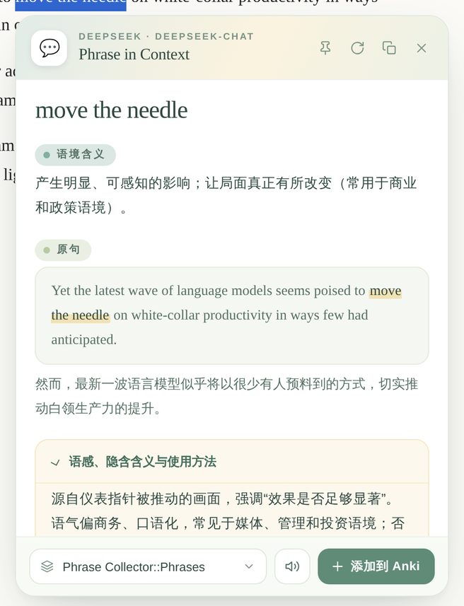
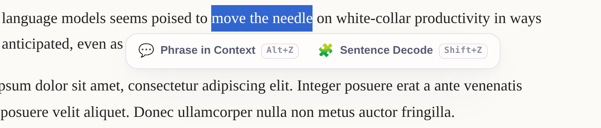
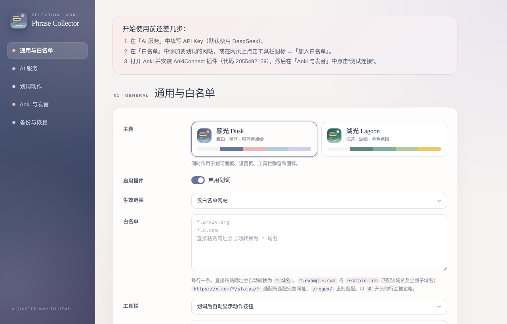
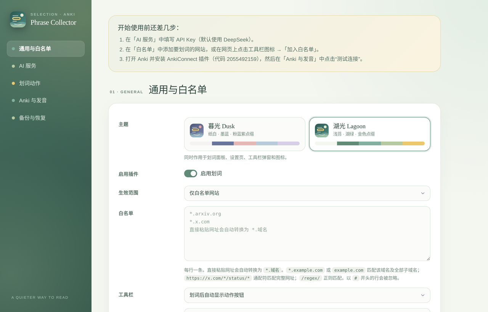

<p align="center">
  
</p>

<h1 align="center">Phrase Collector</h1>

<p align="center">
  划词即解析，一键存进 Anki。<br>
  Select a phrase, let AI explain it in context, and turn it into an Anki card in one click.
</p>

<p align="center">
  <a href="#中文">中文</a> · <a href="#english">English</a>
</p>

<p align="center">
  
  &nbsp;
  
</p>

---

## 中文

Phrase Collector 是一个 Chrome 扩展，面向用英文阅读的中文学习者。在网页上选中一个表达或长句，插件把它连同所在段落发给你自己配置的 AI，按你定义的字段返回结构化解析，再一键通过 AnkiConnect 做成带发音的 Anki 卡片。

纯原生 JavaScript，无需构建，无第三方依赖，也没有服务端：API Key 只保存在本机，请求直接发往你填写的接口。

### 功能

- **自带 API Key 的 AI 划词**：支持任意 OpenAI 兼容接口（DeepSeek、OpenAI、OpenRouter、硅基流动、Kimi、通义千问、智谱、火山方舟、Ollama 等），以及 Anthropic Claude 和 Google Gemini。流式输出，结果边生成边显示，也兼容推理模型。
- **自定义划词动作**：每个动作有自己的 System Prompt、User Prompt、输出字段（JSON）、面板布局（HTML + Liquid 语法）、快捷键和牌组。内置两个动作：
  - 💬 **Phrase in Context**（`Alt+Z`）：解析表达在当前语境中的含义、语感和可迁移句型。
  - 🧩 **Sentence Decode**（`Shift+Z`）：拆解长难句的主干、意群、逻辑和阅读难点。
- **一键制作 Anki 卡片**：自动创建并维护笔记类型，正反面模板已设计好；也可以映射到你已有的笔记类型。网页标题和链接由插件直接写入卡片，不交给 AI，避免编造。
- **卡片发音**：使用 Anki 内置 TTS（可指定语音和语速），或下载有道 / Google 在线音频写入卡片，下载失败时自动回退到 TTS。
- **网站白名单**：只在你指定的网站上启用划词，也可以切换为所有网站。直接粘贴网址会自动转换成通用域名，例如 `https://www.nytimes.com/2026/…` 会变成 `*.nytimes.com`。
- **省 Token 的结果缓存**：在同一页面再次划选同一内容（同一段落）时，直接显示上次的结果，不再请求 AI；已经加入 Anki 的会显示「已添加」。点「重新生成」可以跳过缓存。修改提示词、输出字段或模型后，旧缓存自动失效。
- **可定制的外观**：划词按钮有 Standard（图标 + 名称 + 快捷键）和 Lite（只显示图标）两种样式；每个动作的图标可以从线条图标库或 Emoji 中挑选，也可以输入文字或上传图片。
- **中英文界面**：在「通用与白名单 → 界面语言」中切换中文 / English，设置页、划词面板、弹窗和错误提示都会跟着切换。AI 输出的语言由「目标语言」单独控制，可以从常用语言中选择，也可以直接输入。
- **两套主题**：暮光 Dusk（雾蓝、粉、天蓝、紫）和湖光 Lagoon（湖绿、苔绿、金），同时作用于划词面板、设置页、弹窗、工具栏图标和 Anki 卡片。
- **备份与迁移**：可以导出、导入配置（默认不含 API Key），也可以导入 Read Frog 配置中的自定义动作。

### 安装

Phrase Collector 目前没有上架 Chrome 应用商店，需要以「开发者模式」加载：

1. 下载本仓库（`git clone`，或在 GitHub 上点 **Code → Download ZIP** 后解压）。
2. 打开 Chrome，进入 `chrome://extensions`，打开右上角的 **开发者模式**。
3. 点击 **加载已解压的扩展程序**，选择包含 `manifest.json` 的文件夹。
4. 安装后会自动打开设置页。

Edge、Brave 等基于 Chromium 的浏览器也可以用同样的方式安装。

### 快速开始

1. **AI 服务**：在设置页「AI 服务」中填写 API Key（默认是 DeepSeek），点「测试连接」。可以点「获取模型列表」，从下拉框中选择模型。
2. **Anki**：打开 Anki，安装 [AnkiConnect](https://ankiweb.net/shared/info/2055492159) 插件（工具 → 插件 → 获取插件，代码 `2055492159`），然后重启 Anki。回到设置页「Anki 与发音」点「测试连接」，并在 Anki 弹出的授权窗口中点 **Yes**。
3. **白名单**：打开你常读的网站，点浏览器工具栏中的插件图标，再点「加入白名单」。图标上出现 `ON` 就说明已经生效。

### 使用

<p align="center"></p>

- 选中文字后，点击浮出的动作按钮，或者直接按快捷键。
- 结果面板可以拖动。右上角依次是固定（点击页面其它位置时不关闭）、重新生成、复制和关闭；底部的喇叭按钮可以朗读，按 `Esc` 关闭面板。
- 底部选择这次存入的牌组：点击箭头列出所有牌组，也可以直接输入新名称，修改后会记住。最后点「添加到 Anki」。
- 在动作设置中勾选「生成完成后自动添加到 Anki」，可以省掉手动点击。
- 再次划选同一内容时，会直接显示缓存的结果，不消耗 Token，底部会提示「已显示缓存结果（X 分钟前生成）」；想要新的解析时，点右上角的「重新生成」。

### 设置说明

<p align="center"></p>

| 分区 | 内容 |
| --- | --- |
| 通用与白名单 | 界面语言、主题、生效范围、白名单规则、划词按钮（显示方式与 Standard / Lite 样式）、结果缓存、目标语言、上下文长度 |
| AI 服务 | 多个服务并存；接口类型、Base URL、API Key、模型、Temperature、JSON 模式 |
| 划词动作 | 图标、提示词、输出字段、面板布局、快捷键、牌组、标签、发音字段、笔记类型 |
| Anki 与发音 | AnkiConnect 地址和 Key、TTS 语言、语音、语速，以及在线音频来源 |
| 备份与恢复 | 导出、导入配置，导入 Read Frog 动作，恢复默认设置 |

**提示词变量**：`{{selection}}` 选中文本，`{{paragraphs}}` 所在段落，`{{webTitle}}` 网页标题，`{{webUrl}}` 网页链接，`{{targetLanguage}}` 目标语言。输出字段的 JSON 格式要求会自动追加到 System Prompt 末尾，不需要手写。

**白名单规则**（每行一条，以 `#` 开头的行会被忽略）：

| 写法 | 匹配 |
| --- | --- |
| `*.example.com` 或 `example.com` | 该域名及其全部子域名 |
| `https://x.com/*/status/*` | 用通配符匹配完整网址 |
| `/regex/` | 用正则表达式匹配完整网址 |

### 默认 Anki 笔记类型

| 动作 | 笔记类型 | 字段 |
| --- | --- | --- |
| Phrase in Context | `Phrase Collector · Phrase` | Expression, MeaningZH, ContextEN, ContextZH, NuanceZH, PatternEN, SourceTitle, SourceURL, Audio |
| Sentence Decode | `Phrase Collector · Sentence` | SentenceEN, SentenceZH, Core, Chunks, LogicZH, HardPartZH, Takeaways, SourceURL, Audio |

- 卡片模板可以在「划词动作 → Anki 卡片 → 卡片模板（高级）」中修改，`[[TTS]]` 是发音占位符。
- 在托管模式下，Anki 里的模板以插件中的设置为准。修改发音设置后，点「同步模板到 Anki」即可更新已有卡片。
- 模板里用到、但输出字段中没有的字段，会自动加到笔记类型里，避免 Anki 报「未找到字段」。
- 卡片配色跟随插件主题：暮光是紫色系，湖光是绿色系，也支持 Anki 夜间模式。切换主题时如果 Anki 开着，已有卡片会一起换色，否则下次制卡时更新。自定义 CSS 里可以用 `var(--pc-*)` 引用这些颜色。
- Phrase 卡片背面的「语感」和「可迁移表达」默认折叠，点标题展开。

### 隐私

[隐私政策 / Privacy Policy](https://ChristinaHyh.github.io/Phrase-Collector/privacy-policy.html)

- API Key 和全部设置只保存在浏览器本地（`chrome.storage.local`），不会上传到任何地方。
- 划词内容只发送给你配置的 AI 接口。只有在开启「在线音频」时，才会把发音文本发送给有道或 Google。
- 插件仅在白名单网站上响应划词（除非你切换为「所有网站」）。
- 需要 `<all_urls>` 权限，原因有三：在你选择的网站上注入划词脚本、请求你填写的 AI 接口，以及访问本机的 AnkiConnect。

### 常见问题

- **划词没有反应**：确认工具栏图标上有 `ON`，然后刷新页面（安装或更新插件之前已经打开的页面需要刷新）。Chrome 内置的 PDF 阅读器、`chrome://` 页面和应用商店页面无法注入脚本。
- **报 HTTP 400，并提到 response_format**：这个服务不支持 JSON 模式，在「AI 服务」中关闭「JSON 模式」即可。
- **推理模型**（如 `deepseek-reasoner`）：可以使用，生成前面板会显示「模型思考中…」。Temperature 建议留空。
- **Ollama**：需要先设置环境变量 `OLLAMA_ORIGINS=chrome-extension://*`，再启动 Ollama。
- **连接不到 AnkiConnect**：Anki 需要保持打开。如果在 AnkiConnect 中设置了 apiKey，在插件里也要填写同样的 Key。
- **卡片已存在**：默认会拒绝同一牌组中首字段重复的卡片。可以点划词面板底部的「允许重复添加」按钮（或报错提示里的「允许重复并添加」），也可以在动作设置中开启；开启后同一结果可以「再添加一张」。

### 项目结构

```
manifest.json              MV3 清单
_locales/                  扩展描述的中英文（随浏览器语言切换）
background.js              AI 流式请求、AnkiConnect、在线音频、笔记类型同步、主题图标
content/content.js         划词工具栏与结果面板（Shadow DOM 隔离样式）
options/                   设置页
popup/                     工具栏弹窗（白名单开关、状态检查）
shared/core.js             默认配置、主题、界面语言、迷你 Liquid 模板引擎、宽松 JSON 解析、白名单匹配
shared/i18n.js             界面英文对照表
shared/default-prompts.js  内置两个动作的提示词
icons/                     暮光 / 湖光两套图标（SVG 与 PNG）
```

修改代码后，在 `chrome://extensions` 中点扩展卡片上的刷新按钮，再刷新网页即可。

### 致谢

划词指令的设计参考了 [Read Frog](https://github.com/mengxi-ream/read-frog)，Anki 制卡流程参考了 [ODH (Online Dictionary Helper)](https://github.com/ninja33/ODH)，卡片写入依赖 [AnkiConnect](https://git.sr.ht/~foosoft/anki-connect)。

---

## English

Phrase Collector is a Chrome extension for language learners who read in English. Select an expression or a long sentence on any page; the extension sends it, together with its surrounding paragraph, to the AI provider *you* configure, gets back a structured analysis in the fields *you* define, and turns it into an Anki card with audio through AnkiConnect in one click.

It is plain JavaScript with no build step, no third-party dependencies and no backend: your API key stays in your browser, and requests go straight to the endpoint you set.

> The built-in prompts and card templates are written for **Chinese-speaking learners of English** (explanations in Simplified Chinese). Every prompt, output field and template is editable, so you can adapt it to any language pair.

### Features

- **Bring-your-own-key AI**: any OpenAI-compatible API (DeepSeek, OpenAI, OpenRouter, SiliconFlow, Kimi, Qwen/DashScope, Zhipu GLM, Volcengine Ark, Ollama…), plus Anthropic Claude and Google Gemini. Results stream in as they're generated, and reasoning models are supported.
- **Custom selection actions**: each action has its own system prompt, user prompt, output fields (JSON), panel layout (HTML + Liquid), shortcut and deck. Two are built in:
  - 💬 **Phrase in Context** (`Alt+Z`): explains an expression's meaning in context, its nuance, and a reusable pattern.
  - 🧩 **Sentence Decode** (`Shift+Z`): breaks a long sentence into its core, chunks, logic and the part that trips readers up.
- **One-click Anki cards**: the extension creates and maintains its own note types with ready-made templates, or maps onto a note type you already have. Page title and URL are filled in by the extension itself, never by the AI.
- **Audio on cards**: Anki's built-in TTS (choose voice and speed), or Youdao / Google audio downloaded into the card, falling back to TTS if the download fails.
- **Site allowlist**: selection only works on sites you allow (or switch to all sites). Paste a full URL and it becomes a domain pattern automatically, e.g. `https://www.nytimes.com/2026/…` → `*.nytimes.com`.
- **Result cache to save tokens**: selecting the same text again on the same page (in the same paragraph) shows the previous result without calling the AI, and cards already sent to Anki show as added. Use regenerate to bypass the cache; editing the prompt, output fields or model invalidates old entries automatically.
- **Customizable look**: the selection toolbar comes in Standard (icon, name and shortcut) or Lite (icons only); each action's icon can come from a built-in line-icon set or emoji, or be your own text or uploaded image.
- **Chinese / English UI**: switch under *General & whitelist → Language*. The settings page, result panel, popup and error messages all follow it. The language of AI output is controlled separately by *Target language*, which offers common languages or accepts any you type.
- **Two themes**: Dusk (slate blue, blush, sky, lavender) and Lagoon (lagoon green, moss, gold), applied to the panel, settings page, popup, toolbar icon and Anki cards.
- **Backup & migration**: export or import your settings (API keys excluded by default), and import custom actions from a Read Frog config.

<p align="center"></p>

### Installation

Phrase Collector is not on the Chrome Web Store yet, so load it in developer mode:

1. Get the code: `git clone` this repository, or use **Code → Download ZIP** on GitHub and unzip it.
2. Open `chrome://extensions` and turn on **Developer mode** (top right).
3. Click **Load unpacked** and pick the folder that contains `manifest.json`.
4. The settings page opens automatically.

It also works in other Chromium-based browsers such as Edge and Brave.

### Quick start

1. **AI provider**: under *AI 服务* (AI providers), paste your API key (DeepSeek by default) and click *测试连接* (Test connection). Click *获取模型列表* (Fetch models) to pick a model from the dropdown.
2. **Anki**: open Anki, install the [AnkiConnect](https://ankiweb.net/shared/info/2055492159) add-on (Tools → Add-ons → Get Add-ons, code `2055492159`), then restart Anki. Under *Anki 与发音* (Anki & audio), click *测试连接* (Test connection) and choose **Yes** in the permission dialog that Anki shows.
3. **Allowlist**: open a site you read often, click the extension's toolbar icon, then *加入白名单* (Add to allowlist). An `ON` badge on the icon means it's active on that page.

The interface is currently in Simplified Chinese; the labels above include their meaning in parentheses.

### Usage

- Select text, then click an action button that appears, or press its shortcut.
- The result panel can be dragged around. The top-right buttons pin it (so it stays open when you click elsewhere), regenerate, copy, and close; the speaker button at the bottom reads the expression aloud. `Esc` closes the panel.
- Choose the deck at the bottom: click the arrow to list all your decks, or type a new name (it's remembered). Then click *添加到 Anki* (Add to Anki).
- Enable *生成完成后自动添加到 Anki* (auto-add when done) in an action's settings to skip the click.
- Selecting the same text again shows the cached result without using tokens, with a note at the bottom saying when it was generated. Click regenerate (top right) for a fresh analysis.

### Configuration

**Prompt variables**: `{{selection}}`, `{{paragraphs}}`, `{{webTitle}}`, `{{webUrl}}`, `{{targetLanguage}}`. The JSON format instructions for your output fields are appended to the system prompt automatically.

**Allowlist rules** (one per line; lines starting with `#` are ignored):

| Rule | Matches |
| --- | --- |
| `*.example.com` or `example.com` | the domain and all its subdomains |
| `https://x.com/*/status/*` | full URL, with wildcards |
| `/regex/` | full URL, as a regular expression |

**Default note types**:

| Action | Note type | Fields |
| --- | --- | --- |
| Phrase in Context | `Phrase Collector · Phrase` | Expression, MeaningZH, ContextEN, ContextZH, NuanceZH, PatternEN, SourceTitle, SourceURL, Audio |
| Sentence Decode | `Phrase Collector · Sentence` | SentenceEN, SentenceZH, Core, Chunks, LogicZH, HardPartZH, Takeaways, SourceURL, Audio |

- Card templates are editable under the action's advanced card template settings; `[[TTS]]` is the audio placeholder.
- For note types the extension manages, its templates take precedence over edits made in Anki. After changing audio settings, use *同步模板到 Anki* (Sync templates to Anki) to update existing cards.
- Any field that a template references but the output fields lack is added to the note type automatically, so Anki won't reject the template.
- Card colors follow the extension theme: purple for Dusk, green for Lagoon, with Anki night mode supported. If Anki is open when you switch themes, existing cards are recolored right away; otherwise on the next card you add. Custom CSS can use the `var(--pc-*)` color variables.
- On the Phrase card's back, *Nuance* and *Pattern* are collapsed by default; click the heading to expand.

### Privacy

- Your API keys and all settings are stored locally in `chrome.storage.local` and never uploaded anywhere.
- Selected text goes only to the AI endpoint you configure. Text to be spoken is sent to Youdao or Google only if you turn on online audio.
- The extension only reacts to selections on allowlisted sites (unless you choose all sites).
- It requests the `<all_urls>` permission for three reasons: to run on the sites you choose, to call the AI endpoint you entered, and to reach AnkiConnect on your own machine.

### Troubleshooting

- **Nothing happens when I select text**: check that the icon shows `ON`, then reload the page (pages opened before you installed or updated the extension need a reload). Chrome's built-in PDF viewer, `chrome://` pages and the Web Store can't run extension scripts.
- **HTTP 400 mentioning `response_format`**: the provider doesn't support JSON mode. Turn off *JSON 模式* (JSON mode) for that provider.
- **Reasoning models** (e.g. `deepseek-reasoner`): supported; the panel shows a "thinking" state first. Leave Temperature empty.
- **Ollama**: start it with the environment variable `OLLAMA_ORIGINS=chrome-extension://*`.
- **Can't reach AnkiConnect**: keep Anki open. If you set an apiKey in AnkiConnect, enter the same key in the extension.
- **"Card already exists"**: duplicates within a deck (same first field) are rejected by default. Toggle "Allow duplicates" in the panel footer (or click "Allow duplicate & add" in the error), or enable it per action in Settings; once on, you can "Add another" from the same result.

### Project structure

```
manifest.json              Manifest V3
_locales/                  Extension description in English / Chinese (follows the browser language)
background.js              AI streaming, AnkiConnect, online audio, note type sync, themed icon
content/content.js         Selection toolbar and result panel (isolated in Shadow DOM)
options/                   Settings page
popup/                     Toolbar popup (allowlist toggle, status checks)
shared/core.js             Defaults, themes, UI language, mini Liquid template engine, lenient JSON parser, allowlist matching
shared/i18n.js             English UI strings
shared/default-prompts.js  Prompts for the two built-in actions
icons/                     Dusk / Lagoon icons (SVG and PNG)
```

After editing the code, click the reload button on the extension card in `chrome://extensions`, then reload the page.

### Acknowledgements

The custom selection actions are inspired by [Read Frog](https://github.com/mengxi-ream/read-frog), the card-making flow by [ODH (Online Dictionary Helper)](https://github.com/ninja33/ODH), and cards are written through [AnkiConnect](https://git.sr.ht/~foosoft/anki-connect).
